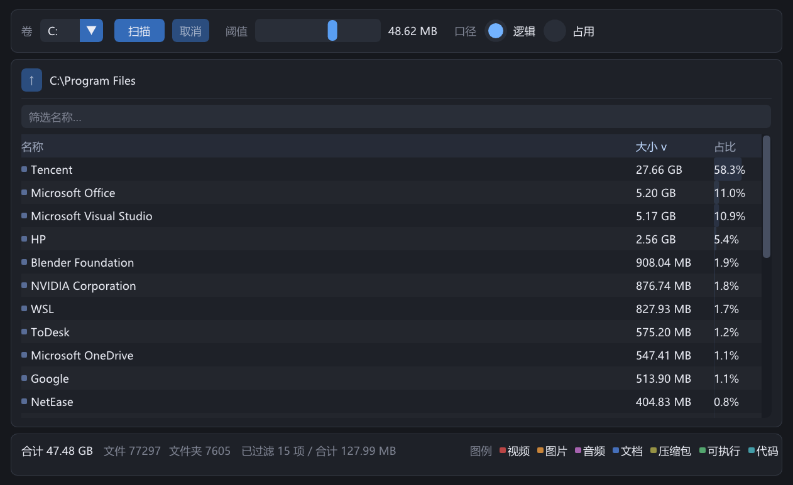

<div align="center">

# SpaceLens

**A blazing-fast NTFS disk-usage analyzer for Windows — it reads `$MFT` directly instead of walking directories.**

[](#requirements)
[](#build)
[](#build)
[](#build)
[](LICENSE)

**English** · [简体中文](README.zh-CN.md)

[Features](#-features) · [Screenshot](#-screenshot) · [Requirements](#-requirements) · [Build](#-build) · [Usage](#-usage) · [How it works](#-how-it-works)

</div>

SpaceLens answers "what is eating my disk?" in seconds. Instead of recursing through
directories with `FindFirstFile`, it opens the volume, parses the NTFS **Master File
Table** (`$MFT`) and rebuilds the whole directory tree in one pass — the same trick
WizTree uses. The result is shown as a size-sorted, drill-down folder list.

---

## ✨ Features

| | |
| --- | --- |
| ⚡ **Whole-volume scan in seconds** | One sequential pass over the MFT with an 8 MB read buffer; no per-file syscalls. |
| 📂 **Drill-down folder list** | Current folder's direct children, sorted by size with a share-of-parent bar. Click a row to descend, breadcrumb to jump back. |
| 🔍 **Sort & filter** | Click headers to sort by name / size / share; filter the current level by name. |
| 🎚️ **Size threshold** | Log-scale slider (1 KB – 10 GB) hides noise. Defaults to ~0.1 % of the root total; the status bar reports what was hidden. |
| 💾 **Logical vs. on-disk size** | Every node keeps both; switch the metric from the toolbar. |
| 🎨 **File-type colors** | Video / image / audio / document / archive / executable / code / other, with a legend. |
| 🖱️ **Context menu** | Open in Explorer, copy path, copy size. |
| 📊 **Live progress & cancel** | Scanning runs on a worker thread; the UI stays responsive and can cancel mid-scan. |

## 📸 Screenshot

<p align="center">
  
</p>

## 🧩 Requirements

| | |
| --- | --- |
| OS | Windows 10 / 11, x64 |
| Filesystem | **NTFS only** (non-NTFS volumes are rejected, no slow fallback) |
| Privileges | **Administrator** — opening `\\.\X:` for MFT access requires elevation (the manifest requests it via UAC) |
| Toolchain | Visual Studio 2022 (MSVC, C++20) — MinGW GCC 15 also builds, but the admin manifest is MSVC-only |

Build-time dependency: [Dear ImGui](https://github.com/ocornut/imgui), vendored as a **git submodule** pinned to a release tag. DirectX 11 ships with Windows.

## 🔨 Build

```sh
git submodule update --init --recursive

cmake -S . -B build
cmake --build build --config Release
```

The executable is `build/bin/Release/spacelens.exe` (single-config generators put it
in `build/bin/`). Release is the default build type.

> **Portable output.** The CRT is linked statically
> (`CMAKE_MSVC_RUNTIME_LIBRARY=MultiThreaded`), so `spacelens.exe` is a single
> self-contained file — copy it to any Windows 10/11 x64 machine and run it. No
> VC++ redistributable, no extra DLLs.

### Tests

```sh
cmake -S . -B build -DBUILD_TESTING=ON
cmake --build build --config Release
ctest --test-dir build -C Release --output-on-failure
```

Tests are on by default `OFF`; they need no admin rights. `tests/unit_tests.cpp` is a
small hand-written runner covering synthetic `FILE` records, an end-to-end scan of a
hand-built in-memory NTFS volume image, and an oracle comparison against a recursive
scanner on a temp directory.

## 🚀 Usage

1. Launch `spacelens.exe` and accept the UAC prompt.
2. Pick an NTFS volume from the toolbar and press **扫描** (Scan).
3. Click a folder row (or a breadcrumb segment) to drill in.
4. Drag the threshold slider to hide small items, type in the box to filter names.
5. Right-click a row for *open in Explorer* / *copy path* / *copy size*.

### Dev & QA environment variables

| Variable | Effect |
| --- | --- |
| `SPACELENS_DEV_DIR=<dir>` | Scan `<dir>` with the portable recursive scanner instead of the MFT (no admin needed). For development only. |
| `SPACELENS_LOG=<file>` | Write a tiny GUI debug log (frame count, node count). |
| `SPACELENS_CAPTURE=<file.bmp>` | Dump the client area to a 32-bit BMP at frame 120 and exit — headless visual QA. |
| `SPACELENS_NO_ADMIN_MANIFEST=ON` (CMake) | Build without the `requireAdministrator` manifest, e.g. for smoke tests. |

## ⚙️ How it works

```
boot sector ─► MFT location / cluster + record geometry
$MFT record ─► its own run list (handles MFT fragmentation)
   │
   ├─ read MFT in large sequential blocks
   ├─ parse FILE records: $STANDARD_INFORMATION, $FILE_NAME, $DATA, $ATTRIBUTE_LIST
   ├─ skip deleted records and NTFS metadata (record# < 16, except root #5)
   └─ rebuild the tree by parent FRN (validating the FRN sequence number)
          └─ aggregate sizes bottom-up into a compact arena of nodes
```

Notes on the parts that bite:

- Sizes come from the **unnamed `$DATA`** attribute (non-resident header / resident
  length), falling back to `$FILE_NAME`. `$STANDARD_INFORMATION` carries no size.
- Large or fragmented files keep `$DATA` in extension records listed by
  `$ATTRIBUTE_LIST`; the scanner follows the list to the lowest-VCN extent. In that
  case the base record's `$FILE_NAME` size is `0` and must not be trusted.
- **Hard links are counted once per directory entry** (same as Explorer), so totals on
  volumes with hard links (`C:\Windows\WinSxS`) exceed the physical usage — expected.
- Names use namespace 0/1/2/3; one name is chosen per parent record, preferring Win32.
- Everything is `uint64_t`; folders can exceed 4 GB.

## 🗂️ Project layout

```
include/            public headers (ntfs, tree, scan, format, utf8)
src/core/           spacelens_core static lib — MFT parsing, tree, scanners (no UI)
src/gui/app.cpp     Win32 + DirectX 11 + Dear ImGui front end
tests/              hand-written unit / end-to-end tests
tools/              optional diagnostics (mft_scan, mft_record) via -DSPACELENS_TOOLS=ON
third_party/imgui   Dear ImGui submodule (don't edit; move the pin to upgrade)
```

Source files are listed explicitly in `CMakeLists.txt` (no globs) — add new files to the
right target. See [`需求文档.md`](需求文档.md) for the full (Chinese) specification and
[`AGENTS.md`](AGENTS.md) for contributor conventions.

## 🗺️ Roadmap

Not in scope for the current version: treemap visualization, arbitrary directory as scan
root, duplicate finder, delete/cleanup, export, real-time monitoring, CLI mode, non-NTFS
and cross-platform support.

## 📄 License

[MIT](LICENSE).
