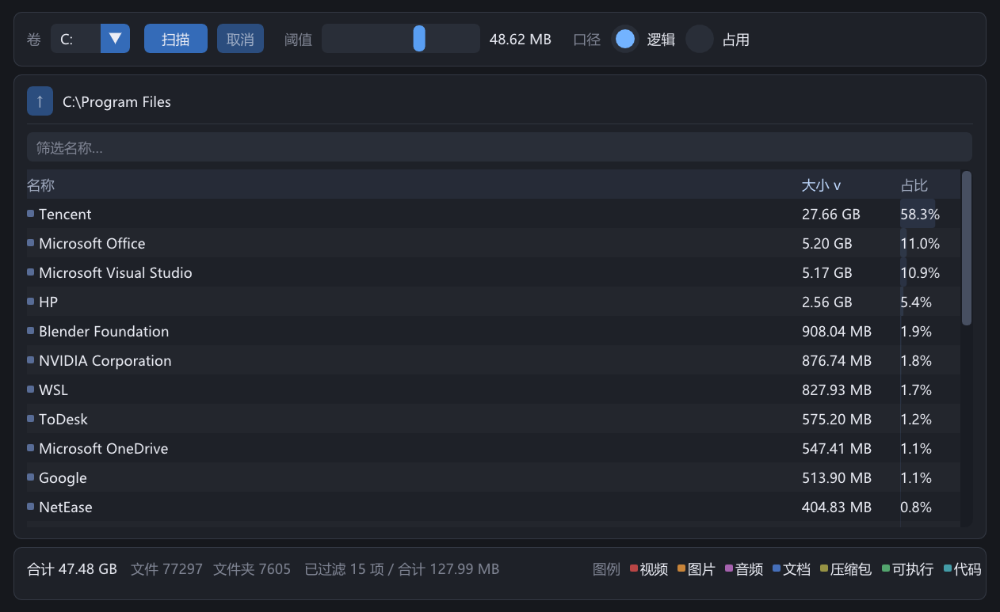

<div align="center">

# SpaceLens

**Windows 上极速的 NTFS 磁盘空间分析工具 —— 直读 `$MFT`，不逐个文件遍历目录。**

[](#-环境要求)
[](#-构建)
[](#-构建)
[](#-构建)
[](LICENSE)

**简体中文** · [English](README.md)

[功能](#-功能) · [截图](#-截图) · [环境要求](#-环境要求) · [构建](#-构建) · [使用](#-使用) · [实现原理](#-实现原理)

</div>

SpaceLens 用几秒钟回答“我的磁盘被什么占满了”。它不递归调用 `FindFirstFile` 遍历目录，
而是以管理员权限打开卷，直接解析 NTFS 的**主文件表**（`$MFT`），一次顺序读完整个卷的
文件记录并重建目录树 —— 与 WizTree 相同的思路。结果以**按大小排序、可逐层下钻的列表**
呈现。

---

## ✨ 功能

| | |
| --- | --- |
| ⚡ **整卷秒级扫描** | 顺序读取 MFT（8 MB 缓冲区），不做逐文件系统调用。 |
| 📂 **逐层下钻列表** | 展示当前文件夹的直接子项，按大小降序并带占父级比例条；点击行下钻，面包屑返回。 |
| 🔍 **排序与筛选** | 点击表头按名称 / 大小 / 占比排序；按名称筛选当前层级。 |
| 🎚️ **大小阈值** | 对数刻度滑杆（1 KB – 10 GB）过滤噪声，默认约为根目录总量的 0.1%，状态栏显示被过滤的数量与合计。 |
| 💾 **逻辑大小 / 磁盘占用** | 每个节点同时保存两种口径，可在工具栏切换。 |
| 🎨 **文件类型配色** | 视频 / 图片 / 音频 / 文档 / 压缩包 / 可执行 / 代码 / 其他，附图例。 |
| 🖱️ **右键菜单** | 在资源管理器中打开、复制路径、复制大小。 |
| 📊 **实时进度与取消** | 扫描在工作线程执行，UI 不卡顿，可随时取消。 |

## 📸 截图

<p align="center">
  
</p>

## 🧩 环境要求

| | |
| --- | --- |
| 操作系统 | Windows 10 / 11，x64 |
| 文件系统 | **仅 NTFS**（非 NTFS 卷直接报错，不做慢速回退） |
| 权限 | **管理员** —— 打开 `\\.\X:` 读取 MFT 必须提权（清单会触发 UAC） |
| 工具链 | Visual Studio 2022（MSVC，C++20）；MinGW GCC 15 也能构建，但管理员清单仅支持 MSVC |

构建期依赖：[Dear ImGui](https://github.com/ocornut/imgui)，以 **git submodule** 引入并锁定
release tag。DirectX 11 随 Windows 提供。

## 🔨 构建

```sh
git submodule update --init --recursive

cmake -S . -B build
cmake --build build --config Release
```

产物为 `build/bin/Release/spacelens.exe`（单配置生成器输出到 `build/bin/`）。默认构建类型是
Release。

> **单文件可分发。** CRT 采用静态链接（`CMAKE_MSVC_RUNTIME_LIBRARY=MultiThreaded`），
> `spacelens.exe` 是自包含的单个文件 —— 拷到任意 Windows 10/11 x64 机器即可运行，
> 无需 VC++ 运行库，也无需附带任何 DLL。

### 测试

```sh
cmake -S . -B build -DBUILD_TESTING=ON
cmake --build build --config Release
ctest --test-dir build -C Release --output-on-failure
```

测试默认**关闭**，且不需要管理员权限。`tests/unit_tests.cpp` 是手写的小型 runner，
覆盖：手工构造的 `FILE` 记录、在内存卷镜像上的端到端 MFT 扫描，以及针对临时目录与递归
扫描器对拍的 oracle 测试。

## 🚀 使用

1. 运行 `spacelens.exe`，在 UAC 提示中允许提权。
2. 在工具栏选择一个 NTFS 卷，点击 **扫描**。
3. 点击某一行（或面包屑）进入下级目录。
4. 拖动阈值滑杆隐藏小项，在输入框里按名称筛选。
5. 右键某行可*在资源管理器中打开* / *复制路径* / *复制大小*。

### 开发 / QA 环境变量

| 变量 | 作用 |
| --- | --- |
| `SPACELENS_DEV_DIR=<目录>` | 改用可移植的递归扫描器扫描指定目录，不需要管理员权限。仅供开发调试。 |
| `SPACELENS_LOG=<文件>` | 输出极简 GUI 调试日志（帧数、节点数）。 |
| `SPACELENS_CAPTURE=<文件.bmp>` | 在第 120 帧把客户区导出为 32 位 BMP 后退出 —— 用于无头视觉 QA。 |
| `SPACELENS_NO_ADMIN_MANIFEST=ON`（CMake） | 构建时不嵌入 `requireAdministrator` 清单，便于自动化冒烟测试。 |

## ⚙️ 实现原理

```
引导扇区   ─► MFT 起始位置 / 簇与记录大小
$MFT 记录  ─► 它自己的 run list（处理 MFT 自身的碎片）
   │
   ├─ 大块顺序读取 MFT
   ├─ 解析 FILE 记录：$STANDARD_INFORMATION、$FILE_NAME、$DATA、$ATTRIBUTE_LIST
   ├─ 跳过已删除记录与 NTFS 元数据（记录号 < 16，根目录 #5 除外）
   └─ 按父 FRN 重建目录树（校验 FRN 序列号）
          └─ 自底向上聚合大小，写入紧凑的 arena 节点数组
```

几个容易踩的坑：

- 大小取自**未命名的 `$DATA`**（非常驻取头部字段，常驻取内容长度），缺失时回退
  `$FILE_NAME`；`$STANDARD_INFORMATION` 不含大小字段。
- 大文件 / 碎片文件的 `$DATA` 可能位于 `$ATTRIBUTE_LIST` 列出的扩展记录中，扫描器会
  跟随列表取 VCN 最低的 extent；此时基础记录的 `$FILE_NAME` 大小为 `0`，不可作为回退。
- **硬链接按目录项各计一次**（与资源管理器一致），因此存在硬链接的卷
  （如 `C:\Windows\WinSxS`）合计会大于物理占用，属预期行为。
- 文件名的命名空间可能是 0/1/2/3；每个父记录挑一个名字，优先 Win32。
- 所有大小均为 `uint64_t`，文件夹可超过 4 GB。

## 🗂️ 项目结构

```
include/            公共头文件（ntfs、tree、scan、format、utf8）
src/core/           spacelens_core 静态库 —— MFT 解析、目录树、扫描器（无 UI 依赖）
src/gui/app.cpp     Win32 + DirectX 11 + Dear ImGui 前端
tests/              手写的单元 / 端到端测试
tools/              可选诊断工具（mft_scan、mft_record），-DSPACELENS_TOOLS=ON 构建
third_party/imgui   Dear ImGui submodule（不要直接修改；升级只需移动 pin）
```

源文件在 `CMakeLists.txt` 中显式列出（不使用 glob），新增文件记得加到对应 target。
完整（中文）需求见 [`需求文档.md`](需求文档.md)，贡献约定见 [`AGENTS.md`](AGENTS.md)。

## 🗺️ 路线图

当前版本不做：矩形树图（Treemap）、以任意目录为扫描根、重复文件查找、删除 / 清理、
导出报告、实时监控、命令行模式、非 NTFS 与跨平台支持。

## 📄 许可证

[MIT](LICENSE)。
